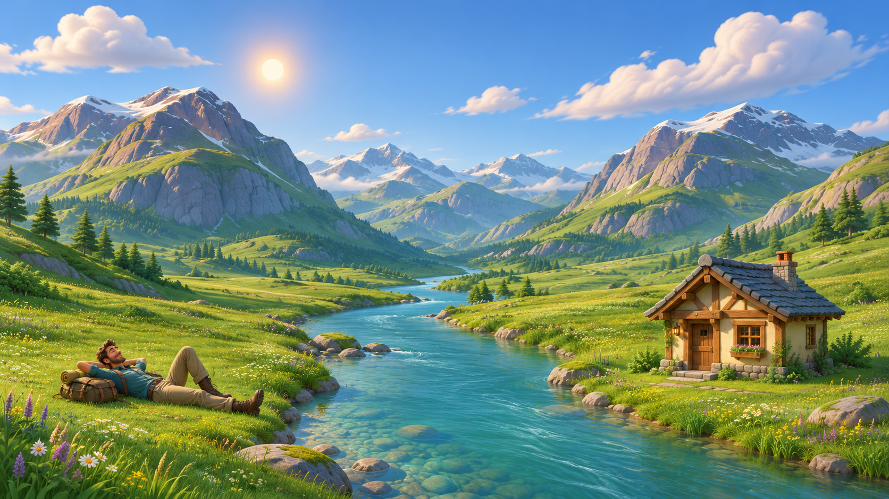

# Hero art-direction review

Status: concept candidate 1 approved by the user on 7 November 2026 as the visual target. Runtime reproduction remains to be implemented and reviewed.

## Why this step exists

The procedural prototype established landmark placement but has not achieved the intended visual quality. Pause further geometry polishing, weather, and scroll expansion until a visual target is reviewed. Preserve existing code for comparison.

## Current concerns

- Mountains feel too tall, narrow, smooth, and clay-like; seek broader irregular alpine masses and open meadow depth.
- Vegetation is too uniformly distributed and spike-like; seek deliberate patches, soft ground cover, and richer material variation.
- Clouds repeat similar silhouettes/heights; compose distinct masses naturally.
- Water needs more depth, bank integration, and restrained reflection.
- House and traveler are explicit primitive placeholders requiring coherent designed replacements.
- Light/color need fresh sunlit greens, cool shadows, and atmospheric separation.

## Review sequence

Review composition, mountain shapes, meadow, lighting/materials, river, house, and character separately. Identify specific accepted/rejected details. A concept image can guide art direction but supplies neither a rig nor usable 3D geometry and does not demonstrate runtime performance.

After approval, the prototype chat should inspect available assets/tools and provide an implementation plan identifying procedural elements to retain, assets to model/source, licensing/provenance, rig/animation needs, and performance risks. Implement one art pass at a time, reviewing stills before animation.

Do not replace the live hero with the generated concept as if that completed the real-time experience. Do not reinterpret any unapproved generated detail as a new requirement.

## Generation provenance

Built-in image-generation tool; input references are the user's composition drawing and latest unapproved landscape capture. Generation prompt is saved alongside this review as hero-concept-prompt.txt. The generated result is approved as the visual target; it is a raster concept, not production geometry.

## First generated candidate

The user approved this image and requested proceeding with it. Its detailed stylized 3D treatment, lighting, meadow, water, cottage, traveler and environmental richness now supersede earlier uncertainty about simpler/rounder styling. Preserve the left traveler, right cottage, central river and expansive layered mountains. Existing scene code is unchanged by this approval. Do not simplify the target back into primitive toy-like geometry.

## Implementation handoff

Read this approved image before modifying the scene. First inspect available tools/assets and propose a concrete reproduction plan: what existing code remains useful, which environment elements require modeled assets/materials, character rig and reclining-to-standing/walking requirements, source/licensing, and performance budget. Do not claim an exact real-time match is guaranteed. Preserve a comparison baseline and implement reviewed passes: terrain/mountain composition, lighting/materials, vegetation/water, cottage/character, then ambient movement. Weather and scroll choreography follow the approved sunny-frame reproduction. A temporary image fallback must be explicitly identified and is not completion of the interactive 3D scene.
