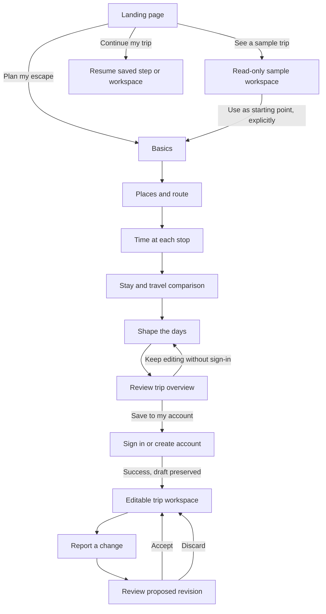

# Elsewhere — landing content and planning wireflow

> **Current landing implementation — 9 November 2026:** [landing-refinement-v3.md](landing-refinement-v3.md) records the accepted landing-first refinement at `/design/fieldtrip`: approved hero art, clearer product story, one connected sample planner, revision example and shared trip pass. Planner wireframes remain separate. Not yet redeployed.

> **Visual wireframes available:** [visual-wireframes-v1.md](visual-wireframes-v1.md) documents the clickable review at `/design/wireframes`, its ten screens and saved previews. Layout review only; the approved hero and live deployment are unchanged.

**Date:** 9 November 2026  
**Status:** Design proposal for review; not an implementation change.  
**Scope:** Landing content, entry paths, guided planning screens, shared draft behavior and handoff to the trip workspace.  
**Product authority:** [PRD](../tripadapt-prd.md), [API design](../tripadapt-api-design-v1.md), [database design](../tripadapt-database-design-v1.md). This document describes UX behavior, not new API contracts.

## 1. Decisions already accepted

- Keep the approved Fieldtrip hero artwork and visual composition. Supporting sections should share its illustration quality and palette, with distinct subjects rather than repeated scenery.
- Let people plan before signing in. Request authentication for account-based saving.
- Begin with origin, travelers and date flexibility.
- Suggest editable defaults. Review consequential proposed revisions before accepting them.
- Support multiple destinations, repeated stops, flexible dates and durations without arbitrary trip-length limits.
- Keep initial planning connected to on-trip adaptation. A beautiful summary is not the end of the product experience.
- Use an in-app calendar in V1. External calendar account synchronization is deferred.
- Current visual review is desktop-focused. Mobile layouts are a later design task.

## 2. What the landing page must communicate

A visitor should be able to answer: What is Elsewhere? What can I create? What happens when my trip changes? Where do I begin?

**Positioning:** Elsewhere connects destinations, dates, stays, transport and activities into an editable trip, then helps revise that trip when circumstances change.

**Boundary:** The landing page explains and demonstrates. The planner collects the actual trip details. Visitors should not complete an apparent planning form on the landing page and then repeat it after starting.

## 3. Landing sections and exact draft copy

### L1 — The invitation

Keep the existing landscape and headline:

> Leave the usual behind.

Replace the supporting copy with:

> Plan your places, stays and journeys together. Leave a little room for life to happen.

- Primary CTA: **Plan my escape** → start a new personal draft at Basics.
- Secondary link: **See a sample trip** → read-only sample workspace.
- Supporting reassurance: **Dates can come later.**
- Header action: **Start planning** → the same entry as the primary CTA.
- Returning visitors with an accessible draft see **Continue my trip** and a separate **Start a new trip** action. Starting over must not silently overwrite their draft.
- Keep scene-pause controls. The scene never delays access to the CTA.

### L2 — Explain the product through one connected example

Headline:

> Your places, stays and journeys. One connected plan.

Body:

> Choose where you want to go. Shape the days around your time, budget and pace. Keep the details together as your trip takes shape.

Show a compact, interactive example, not another full scenic hero:

```
[Illustrated place choices]     [One shared sample trip]
Jibhi     Sainj     Shangarh    Delhi → Jibhi → Sainj → Delhi
[Add / remove]                 3 nights   2 nights
                              Stay + travel estimate
                              [Inspect the sample]
```

- Label the entire demonstration **Try a sample trip**.
- Adding a place changes its route, total nights and illustrative estimate together.
- An optional duration adjustment demonstrates the same connection; do not add a separate full calendar form here.
- Keep a single, editable example state through L2–L4. Do not reset each section to unrelated destinations or totals.
- Short price disclosure: **Sample allowances, not live prices. Some expenses remain unpriced.**
- CTA: **Inspect the sample** → sample itinerary with the example's current state.
- Link: **Plan my own escape** → Basics, with an empty personal draft.

The sample state is not silently imported into a personal trip. If an explicit **Use this as a starting point** action is offered in the sample workspace, it copies the route and preferences into a new personal draft; example dates, weather, offers and booking claims are cleared.

### L3 — Show why adaptation matters

Headline:

> When the day changes, your whole trip doesn’t have to.

Body:

> Review a different way to spend the day, while keeping your important commitments in place.

Use the same sample trip from L2. A rain control changes one outdoor activity into an indoor proposal. Display:

- **Before:** outdoor activity, time and relevant condition.
- **Proposed:** replacement activity, time and illustrative cost difference.
- **Unchanged:** the fixed evening transfer.
- Primary demo action: **Try this change**.
- Alternative: **Keep the original**.

Label it **Illustrated weather example**. The demo changes no supplier reservation. If a preceding sample edit removes the affected activity or stop, choose a relevant example from the resulting itinerary or explain that a sample activity is needed; do not leave a stale proposal attached to the wrong destination.

### L4 — Show the outcome

Headline:

> A whole trip you can make your own.

Body:

> See the route, the days and the costs together. Open the details whenever you need them.

Show a trip-pass preview derived from the same example: route, duration, traveler count and indicative cost. Include a small revision indicator if the rain alternative was accepted.

- CTA: **Open the sample itinerary** → the example workspace.
- Secondary CTA: **Plan my escape** → Basics.
- Avoid aircraft-specific branding for bus or rail trips. Label it **Trip overview**, not a boarding pass, receipt or booking confirmation.
- Put detailed activities, packing guidance and cost breakdown behind expandable views, not tiny text on the pass.

### L5 — Questions and footer

Keep three concise questions:

1. **Can I start without dates?** — Yes. Start with places or a rough duration; check dated offers and forecasts when you know more.
2. **Does Elsewhere book the trip for me?** — No. Plan and compare here; complete reservations with the relevant provider.
3. **Who decides when the plan changes?** — You do. Review a suggested revision before keeping it.

Footer invitation: **Make room for your elsewhere.**  
Primary CTA: **Start planning**.  
Navigation: **Explore the example**, **How changes work**, **Start planning**, **Back to the view**.

Do not add fake contact links, testimonials, provider partnerships or guarantees. Authentication/privacy links should exist only when their actual destinations are implemented.

## 4. Entry and end-to-end wireflow



Every guided screen offers Back, Save draft/continue later where supported, and a compact summary. Back retains values. Progress is **Basics → Places → Time → Stay & travel → Days → Review**. Unvisited steps cannot be treated as complete simply because a visitor clicks their label.

## 5. Screen-by-screen wireframes

### P1 — Basics

**Title:** Where does your escape begin?  
**Instruction:** A few details to build around. You can change them later.

```
[Progress]                                  [Draft summary]
Origin: [Search town / airport / station]    Origin
Travelers: [adults] [children, if any]        Travelers / rooms
Rooms: [count, editable]                    Dates or flexibility

When would you like to go?
( ) Exact dates   ( ) Flexible window   ( ) Not sure yet
[Contextual calendar / duration inputs]

[Optional: budget + currency] [Optional: pace]
[Continue to places]
```

- Origin and at least one traveler are required to continue. Destination exploration can still be opened without them through the sample/browse path.
- Do not silently assume a room count from traveler count. Offer a clearly editable initial value. Children’s ages are requested only when needed for a provider search.
- Exact mode: departure and return dates. Explain whether dates are inclusive travel dates; derive elapsed nights separately.
- Flexible mode: optional earliest/latest dates and desired duration, distinguishing duration unit (days/nights).
- Not sure: optional duration; no invented dates. An unsized trip remains a valid incomplete draft.
- Budget is optional. Default is a target; strict budget is an explicit later setting.
- CTA: **Continue to places**. Invalid fields get inline messages; retain all valid fields.

### P2 — Places and route

**Title:** Where would you like to go?

```
[Mountains] [Coast] [Something different] [Search anywhere]
[Suggestions with short reasons and Add]

Your route:
Origin → [Stop] → [Stop] → [+ Add a place] → End location
[Reorder buttons / optional drag interaction]
[Return to origin ✓] or [Choose another finish]

[Back]                           [Plan the time]
```

- Themes guide suggestions; they do not restrict where a trip may go.
- Add places through search or manual entry when coverage is unavailable. Identify the location sufficiently to distinguish namesakes.
- Repeated destinations are separate stop occurrences, not accidentally deduplicated.
- At least one destination is needed for the guided itinerary path. No arbitrary maximum number of stops.
- Reordering preserves each stop's preferences and indicates affected transfers. Never silently optimize away a user-chosen order.
- Show suggestions as researched/provider-backed content when available; distinguish illustrative content during prototyping.

### P3 — Time at each stop

**Title:** Give each place a little time.

```
[Calendar / undated duration timeline]       [Available / allocated / unallocated]
Origin → transfer → Stop A → transfer → Stop B → finish
                      [- 3 nights +]           [- 2 nights +]

[Suggest a split]   Pace: [Relaxed / Balanced / Active]
[Reason for suggested allocation]
[Back]                              [Compare stays & travel]
```

- Users can enter durations directly or request an editable suggestion. Do not repeatedly regenerate after each manual adjustment.
- A suggestion is shown as a proposal before replacing an existing allocation.
- Travel occupies the timeline; overnight services and arrival dates matter. A transfer day may also include a stay or activity, so do not double-count it as an extra whole day by default.
- Exact dates: show allocated nights and remaining capacity. Flexible/unknown dates: use relative days and durations, clearly provisional.
- Day visits are allowed without an overnight stay; do not impose one night at every destination.
- If an allocation exceeds fixed dates, offer **Shorten stays**, **Change dates**, or **Save an unresolved draft**. Do not label it ready for dated comparisons.
- If duration is unspecified, offer **Continue with provisional options** rather than inventing a complete total.

### P4 — Stay and travel

**Title:** Find your way there. Find a place to land.

```
[Route with selected leg / stop]          [Stay + travel estimate]
Stay at selected stop:                   Group total / per person
[Hostel bed] [Private room] [Other]       Priced / estimated / unknown
[Comparable options; dates, occupancy]

Travel to next stop:
[Bus] [Rail] [Private transfer] [Other supported modes]
[Duration, schedule/estimate, fare basis, source]
[Add something already booked]

[Back]                             [Shape the days]
```

- Start with reasonable preferences, not invented selected offers. Actual lodging availability and transport coverage depend on dates, location and occupancy.
- Show hostel prices per bed and rooms per room; private vehicle prices per vehicle where applicable. Calculate group totals accordingly.
- Separate a broad allowance, retrieved offer and user-entered amount. Include retrieval time and known inclusions on expandable details.
- Unsupported search offers manual entry or a provisional allowance. It does not mean no service exists.
- Selecting an option is not booking. Existing bookings and user-fixed times are explicitly represented.
- Unknown costs remain unknown; don't treat them as zero. Travelers can proceed with an incomplete estimate, visibly marked.
- Date/order edits invalidate affected offers and checks, not the entire trip's unrelated choices.

### P5 — Shape the days

**Title:** How much would you like to leave open?

```
[Suggest my days] [Keep my days open]
Pace / interests / must-do items (editable, optional)

[Destination / day selector]
Arrival + transfer buffers
Activities / meal breaks / free time
[Add] [Move] [Replace] [Keep fixed]

[Back]                              [Review my trip]
```

- Generation considers stays, transfers, hours, pace, preferences and available weather. It returns an editable proposal, not a mandatory packed schedule.
- Show an optional preference to reduce walking or changes; do not collect a long questionnaire before showing value.
- Keep unscheduled requested items visible with reasons. Missing hours or durations produce provisional checks, not false validation.
- Weather appears where it changes a decision. Outside the supported forecast horizon, show labeled seasonal information or no weather, not a date-specific prediction.
- On generation failure, retain the draft and offer retry or manual planning. Users can keep days open and continue.

### P6 — Review and account save

**Title:** Your escape, all together.

```
[Trip overview / ticket-inspired visual]
Name, dates/flexibility, travelers
Route and time at each stop
Stay + transport + known activity costs

[Expand itinerary] [Expand costs] [Weather & packing]
[Outstanding checks with Edit links]

[Keep editing]                [Save to my account]
```

- The trip pass is a summary of the same draft, not a separate document users edit independently.
- The cost view distinguishes group/per-person amounts, estimates, paid amounts if entered, and unknown expenses. Do not label a value “balance due” unless a real payable obligation exists; this product does not collect payments in V1.
- Packing guidance is optional and conditional on destination, activities and available conditions. Never confidently infer snow from an unavailable forecast.
- Readiness states: **Draft**, **Needs review**, **Ready to save**. Saving incomplete plans is allowed; saving is not a claim of supplier confirmation or validated feasibility.
- Users can inspect the overview without signing in. **Save to my account** invokes authentication, preserves the draft through success/failure/cancellation, then returns to the trip rather than the homepage.
- For authenticated users, the same action saves directly. Server authorization, guest draft lifetime and merge behavior must follow the auth/API design; do not invent guest access to protected endpoints.
- If an account already has another draft, offer an explicit choice rather than overwrite or merge silently.

### W1 — The trip continues

After account save, open the editable workspace. Primary views: **Today**, **Whole trip**, **Costs**. A prominent **Change my plan** action opens disruption input (weather, delay, fatigue or changed preference).

A revision preview lists changes, preserved commitments, cost differences, uncertain data and supplier actions. Actions: **Keep this revision**, **Keep my current plan**. Accepted revisions update the same trip and its overview; completed and fixed items remain protected. If no valid revision fits the hard constraints, explain the conflict and let the user choose what to change.

## 6. Shared state and dependency behavior

Conceptual UX state follows the existing Trip / DestinationStop / Stay / TransportLeg / Activity / Revision model. These are not new request schemas.

| User change | Keep | Recheck or recompute |
|---|---|---|
| Dates | Destinations, preferences, saved ideas | Stop dates, stays, services, forecast, opening hours, totals |
| Traveler/room count | Route and general interests | Occupancy eligibility, rooms/beds, fares, group/per-person totals |
| Destination order or end location | Stop identity, duration preferences, unrelated notes | Adjacent legs, arrival dates, affected stays/activities |
| Time at one stop | Other choices where still compatible | Downstream dates, affected offers, daily allocations |
| Stay choice | Route and activities that still fit | Local travel origins, timing, stay cost |
| Transport choice | Destinations and unaffected activities | Arrival/departure windows, buffers, feasible day plans |
| Budget or pace | Fixed/complete items | Recommendations; show conflicts before proposed changes |
| Accepted revision | Protected commitments and history | Affected itinerary, costs, overview and readiness |

Do not silently accept a new route, regenerate edited days, relax a strict budget or move a fixed booking when a dependency changes. Identify what needs attention and offer a proposal.

## 7. Navigation, persistence and accessibility

- Keep a compact summary visible: route, dates/flexibility, travelers and price completeness. Do not crowd it with every activity.
- Previous completed steps are revisitable. Direct links to later steps show the missing prerequisites with a return path, not a blank/error page.
- Preserve input on validation, network failures and authentication cancellation. Show retry without clearing the screen.
- Autosave only where the persistence mechanism actually supports it; display Saving/Saved/Not saved accurately. Explicitly label browser-local drafts, expiration and device limitations if that is the guest implementation.
- Warn before discarding unsaved changes or replacing a draft. Handle stale server versions according to the approved revision/concurrency model.
- Use keyboard-accessible calendars, date text entry, non-drag reorder controls, labeled steppers and inline error associations. Respect reduced motion. Animation never carries essential information alone.
- Do not require account connection, geolocation or external calendar permissions to try planning.

## 8. Review scenarios

1. Exact-date, two-traveler multi-stop trip: all screens preserve data, comparisons use the right occupancy, review matches the itinerary.
2. Undated trip: explore and allocate relative durations; no fabricated live offers/forecast; save an incomplete draft.
3. Long trip with repeated destination and a different finish: no arbitrary length/stop restriction; each visit remains distinct.
4. Overnight transfer: arrival lands on the correct date, buffers are visible, no double-counted trip duration.
5. Allocation exceeds exact date range: explain and resolve, or save a conflicted draft without declaring it ready.
6. Change dates after comparison: affected offers become stale; preferences and unrelated choices remain.
7. Provider outage or missing inventory coverage: show partial results and manual/provisional paths; don't fabricate prices.
8. Authentication canceled/failed at save: complete guest draft and current screen remain available.
9. Rain revision with a fixed transfer: inspect alternative, cost difference and unchanged commitment before accepting.
10. Landing sample edited then personal planning started: no silent transfer of sample dates/prices or bookings.

## 9. Design and implementation boundary

This document does not change the production site, PRD, API or database contract. Its next deliverable is a low-fidelity wireframe set: landing L1–L5 plus P1–P6 and the revision handoff, using one sample trip throughout. Final illustration/motion polish follows review of those layouts and interaction states.

Technical follow-ups before implementing the flow: reconcile guest-draft persistence and authenticated-save behavior with the API/auth architecture; establish provider coverage and forecast horizons; define routing from the existing `/trips/new` and `/trips/demo` surfaces without duplicating trip state. Screen names above are UX stages, not a requirement for six new URL routes.
