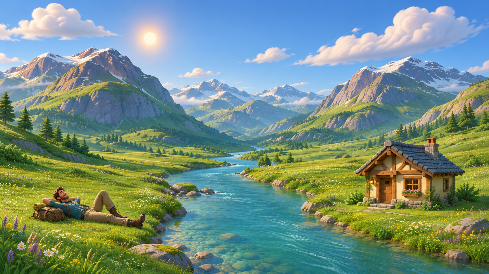
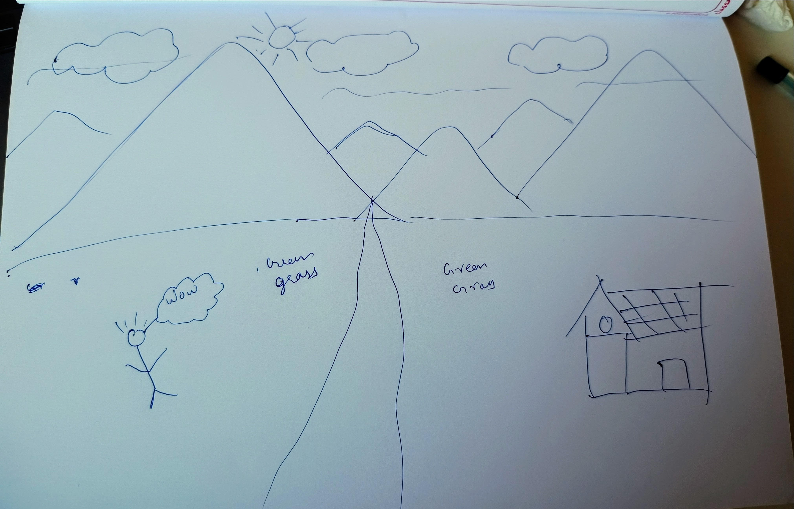

# Elsewhere — Visual Direction and Cross-Chat Brief

> **Current landing implementation — 9 November 2026:** [landing-refinement-v3.md](landing-refinement-v3.md) records the accepted landing-first refinement at `/design/fieldtrip`: approved hero art, clearer product story, one connected sample planner, revision example and shared trip pass. Planner wireframes remain separate. Not yet redeployed.

> **Visual wireframes available:** [visual-wireframes-v1.md](visual-wireframes-v1.md) documents the clickable review at `/design/wireframes`, its ten screens and saved previews. Layout review only; the approved hero and live deployment are unchanged.

> **Current flow proposal — 9 November 2026:** See [landing-and-planning-wireflow-v1.md](landing-and-planning-wireflow-v1.md) for landing content, exact CTA behavior and the guided planning journey. The Fieldtrip hero remains approved; older storyboards below are historical visual explorations. This proposal is for review and has not been implemented.

> **Current approved hero — Fieldtrip:** The user approved the mountain-pasture hero at `/design/fieldtrip`; preserve it. The sections below now follow a connected illustrated journey with one muted meadow ground, interactive destination pins, route/stay controls and a weather-replanning scene. See [fieldtrip-connected-journey.md](fieldtrip-connected-journey.md) for the current below-hero design and [fieldtrip-direction.md](fieldtrip-direction.md) for the hero. Desktop is the target. Scenery is drawn in frontend code; reference images are not backgrounds. Older directions below are historical context, not constraints.

> **Current desktop review — wooded river and cottage:** The user requested a coherent river source, richer trees/grass and a better integrated house, using the supplied forest image as inspiration only. The current river banks and reflections share one course; its headwaters emerge through woodland. The cottage is lower and oblique, with contact planting and an entrance path. See [stillwater-woodland-pass.md](stillwater-woodland-pass.md). The user explicitly deferred mobile optimization; focus subsequent design reviews on desktop.

> **Latest refinement — natural landscape and visible wind:** The user rejected the coarse SVG terrain and weak motion. The current `/design/stillwater` scenery uses native Canvas 2D, cached terrain, irregular ridge contours, textured forest crowns and individually bending grass blades. No scene images or 3D engine are used. See [stillwater-landscape-refinement.md](stillwater-landscape-refinement.md) and `LandscapePainter.ts`. Prior SVG/image notes below are historical.

> **Earlier implementation — code-built scenery:** The user clarified that the scenery must be built directly in the frontend, with independently moving river, grass and clouds. `/design/stillwater` now uses React SVG and CSS scenes with no raster imagery. See [stillwater-code-scenery.md](stillwater-code-scenery.md) and `apps/web/app/design/stillwater/NatureScene.tsx`. Image-based concepts below are historical.

> **Historical direction — Stillwater v2, 8 November 2026:** The user clarified that the reference is atmosphere guidance, not a background asset to reuse. The revised page at `/design/stillwater` uses five original generated paintings (including a portrait companion) and no supplied bitmap. See [stillwater-v2-direction.md](stillwater-v2-direction.md) and [the exact image prompts](stillwater-v2-image-prompts.md). This version is ready for review; prior notes below describe earlier explorations.

> **Earlier exploration — 8 November 2026:** The user prefers a subtler anime-influenced illustrated setting over the overt pencil/cartoon collection. The current concept is **Stillwater**, using their supplied forest/lake/bench artwork with restrained interface design. See [stillwater-direction.md](stillwater-direction.md) and `/design/stillwater`. This is a concept for review, not yet an approved final UI. Earlier directions below are historical context.

> **Earlier exploration — 8 November 2026:** The user requested a fresh pencil-stroke/cartoon direction and rejected the rendered scenery and dimensional character in the valley prototype. See [sketchbook-design.md](sketchbook-design.md) and `/design/sketchbook`. This is a new design for review; the older 3D references below are historical context, not constraints on this exploration.

**Updated:** 7 November 2026  
**Status:** Agreed creative direction; sunny concept frame approved; runtime assets, motion timing, and implementation approach remain to be validated.

## Read this first

This file and [landing-storyboard.md](landing-storyboard.md) preserve the design context developed with the user. Read both before designing or implementing the landing experience. Do not treat previous generated screens, code, or placeholder assets as approved artwork merely because they exist.

Product/technical baselines are at the repository root:
- [PRD](../tripadapt-prd.md)
- [System architecture](../tripadapt-system-architecture-v1.md)
- [Database design](../tripadapt-database-design-v1.md)
- [API design](../tripadapt-api-design-v1.md)

Those documents define product behavior. These two files define the landing experience. If implementation requirements conflict, identify the conflict rather than silently changing either design. Elsewhere is a provisional public-facing name; TripAdapt is the project name.

## Approved visual target — 7 November 2026

The user explicitly approved this generated image and requested proceeding. Use it as the primary reference for visual quality, materials, lighting, colors, vegetation, river, cottage and character treatment. The original drawing remains the composition origin. The approved image resolves earlier open questions in favor of a richer, detailed stylized 3D animated-film environment, with naturalistic detail, rather than simplified rounded primitives. Its environmental detail, including trees and flowers, is accepted as part of this target. Exact runtime assets, typography, and animation remain implementation/review work. See [art review and implementation handoff](hero-art-review.md). Do not ask the user to select a simpler style again unless a concrete new constraint requires a trade-off.

This is a visual target, not a rig, 3D asset package, or proof of browser performance. Preserve the existing implementation until a reproduction approach has been assessed.

## 1. Product and intended feeling

A small-scale travel product with real-use intent, not a portfolio-only presentation. It supports discovery, flexible multi-destination planning, accommodation, transport, budgets, and adapting plans when weather, timing, or user preferences change. Plans are proposals until accepted; actual supplier bookings/payments are outside scope.

The lifestyle invitation is to take a break, explore, and make space for experiences. Welcome adventure, rest, companionship, and different environments without promising psychological transformation or limiting the product to wellness/solo travel.

The user wants an experience that feels alive, fun, beautiful, and worth exploring. Subtle, thoughtful details matter. Relaxation must not become dullness; personality must not become constant distraction.

## 2. The authoritative visual reference

The user drew this layout. It is authoritative for the first-screen spatial composition, not for the rendering style. The words “green grass” mean **lush green grass**. The drawing is an abstract arrangement to turn into a polished 3D scene.

- Mountain range across the upper/background area.
- Dominant large mountain on the left; another dominant mountain on the right.
- Smaller overlapping peaks between/behind them.
- Sun upper-left-of-center near the left peak; clouds spread above the range.
- Central river source between mountains, widening toward the foreground and reaching the bottom edge, slightly left-of-center toward the front.
- Broad continuous meadow on both banks.
- Relaxed person on the lower-left riverbank.
- Small pitched-roof house on the lower-right riverbank.
- View across the meadow toward the mountains, slightly elevated enough to see the ground and river depth.

Preserve these relationships. Do not rearrange into a conventional text-left/image-right hero. The scene itself occupies the viewport.

## 3. Art direction — explicitly settled

**The entire environment and person are stylized 3D.** Mountains, river, grass, house, clouds, character, and props belong to one cohesive animated world. The user explicitly corrected an earlier interpretation of photographic scenery with a character layered over it.

Target qualities:
- Pleasing sculpted forms and dimensional lighting.
- Soft edges and tactile materials, with enough detail to feel crafted.
- Lush greens, soft blue sky, warm sunlight, harmonious mountain tones.
- Depth through scale, overlap, atmospheric separation, shadows, and perspective.
- Water with visible flow and soft reflections; grass with wind-responsive movement.
- Natural contact shadows grounding feet, body, house, and props.
- A broad landscape extending beyond the frame, not a floating island/diorama.

Not yet selected: exact rendering/material style, character model, body proportions, clothing colors, fonts, accent palette, or asset vendor. “Animated-film-like” describes quality and coherence, not a requirement to copy a specific studio.

Earlier mountain photographs inform mood, landscape scale, and atmosphere only. Their photographic treatment is not the current target. Prayer flags were discussed earlier but are not a required element of the final sketch; do not add them automatically.

## 4. Character

One recurring stylized 3D human traveler. Personality mixes a mischievous adventurer with a laid-back mountain philosopher. He reflects the user's love of mountains without needing to be a literal portrait.

Opening: comfortably reclining/lying on the left-bank grass, relaxed and enjoying the setting. Later he notices the visitor, rises, approaches, introduces himself, and guides feature demonstrations. At the end he gets tired of explaining and returns to rest.

Continuity requirements:
- Same identity, face, proportions, clothes, and recognizable details throughout.
- Props persist logically; a backpack left on the grass must not teleport onto him.
- Gestures, eye direction, weight shifts, foot contact, scarf response, and pauses matter.
- Character is secondary to the hero landscape but becomes more prominent during introduction.
- No permanent speech bubble or fixed chat-avatar treatment.
- Humor is friendly, occasional, and discoverable; never blocks essential actions.

Character name and biography are not finalized. Do not invent a permanent name/history. Sample dialogue is draft, not locked copy.

## 5. Motion language

Opening weather sequence, requested by the user:
1. Rain and distant thunder/lightning over the scene.
2. Over approximately 10–15 seconds, rain eases and clouds clear.
3. Sunlight illuminates the meadow.
4. Clear-weather ambient animation continues: clouds sometimes shade the sun, grass sways, river flows, lighting shifts softly.

The same world remains visible; weather changes rather than replacing one unrelated clip with another. Hero camera is mostly stationary. Scroll transitions may move it deliberately.

After the hero, character/scene progress follows scrolling. Movement has a reason: approach the visitor, show postcards, unfold a map, react to weather, return to rest. Vary composition and entrances without teleportation or arbitrary jumps.

Experience guardrails discussed: controls usable during intro; optional “Skip to sunshine”; sound off unless enabled; reduced-motion still compositions; fast scrolling reaches coherent resting states. Final choreography must be tested, not assumed from static screens.

## 6. Page structure

Use **one combined direction**: connected scenes within the same world → physical map becomes workspace → return to the world. Do not generate Connected Scenes and World-to-Workspace as separate alternative products unless explicitly requested.

The user initially preferred a continuous world. Preserve continuity through recognizable terrain, river/trail, house, lighting, and character. Connected framing and workspace transition are practical ways to express that preference, not permission to create unrelated sections.

User requests **one screen/stage at a time**. Hero and introduction have detailed prompt context; later scenes are narrative proposals to design/review progressively. Do not generate the entire page without authorization.

## 7. Interface and product visibility

The scene establishes the atmosphere. Text and controls occupy deliberately composed quiet areas and remain readable without covering the central river, person, house, or important mountain silhouettes.

Minimal navigation and one clear primary invitation are proposed. Exact labels, typography, and placement remain open. Sample hero copy: “Some days, you need a different view.” Sample CTA: “Find my elsewhere.” Treat these as editable candidates.

Feature stages need three layers:
1. Short character dialogue with personality.
2. Clear benefit/heading.
3. Readable product preview demonstrating real behavior.

Interface surfaces become more stable and readable as the map transforms into the workspace. Do not render dense schedules as tiny text on 3D props. Distinguish accepted plans, draft/proposed changes, estimated costs, unknown data, and booked/fixed commitments. Technical agents, tokens, internal logs, or system graphs do not belong in traveler-facing UI.

## 8. Rejected interpretations and lessons

Do not repeat:
- Photorealistic valley or real footage as the main style.
- Photograph with an unrelated cartoon pasted over it.
- Flat CSS/vector mountains and cartoon mockups as final art.
- Static Stitch screens treated as proof of animation quality.
- A formal luxury travel journal: cream/berry palette, oversized literary serif, monographs, charters, invented solitude ratings.
- Conventional hero dominated by destination/date/guest search fields.
- Busy feature-card grids replacing the living landscape story.
- Whole-site regeneration when only one stage was requested.
- Separate concepts when the user requests their combined narrative.

Stitch can help with composition, UI, and storyboard frames. The missing 3D feel requires actual coherent artwork/assets and a motion prototype; more descriptive text alone will not supply production models, rigs, or animation.

## 9. Recommended validation workflow

1. Inspect the drawing and any existing assets; label unapproved/generated placeholders.
2. Establish one polished sunny hero frame matching the drawing before expanding.
3. Select/create environment assets and a rigged character capable of reclining, standing, walking, gesturing, and resting.
4. Prototype the sunny hero's light, wind, clouds, water, and grass.
5. Add the rise-and-approach transition to screen two.
6. Add the weather transition after the base visual direction works.
7. Review with the user before developing later stages.

Real-time 3D was recommended for scroll/click interaction, but specific tooling and asset approach are not approved technical dependencies yet. Next.js/TypeScript frontend remains agreed. A rendered animation approach remains an alternative if selected after evaluating quality/performance needs.

## 10. Cross-chat working agreement

Each working chat should read this file, the storyboard, relevant technical baselines, and applicable repository instructions. Do not assume access to other chats' full history.

Before changing creative direction, distinguish approved requirements from proposals. Keep changes scoped to the assigned scene/module. Record asset provenance, placeholder status, modified paths, unresolved choices, and results. Update these briefs when the user makes a new decision; do not overwrite agreed composition based on an assistant's aesthetic preference.

Open decisions: final character appearance/name, typography/palette, exact copy, actual 3D tools/assets, performance targets, animation timing outside the opening range, and later-stage compositions. No final visual implementation has been approved merely by approving this written direction.
