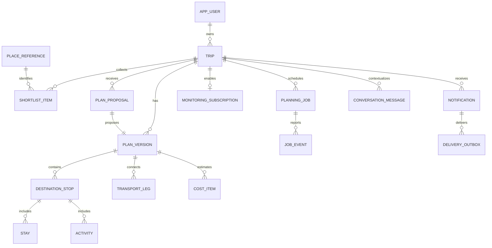

# TripAdapt — PostgreSQL Database Design

**Approval:** Product and technical design baseline approved on 3 November 2026. Unselected vendors, credentials, quotas, notification channel, and other explicitly pending implementation choices remain open; approval does not imply provisioning or implementation.
**Version:** 1.1 draft · **Date:** 2 November 2026  
**Baseline:** Approved PRD and system architecture. This is the approved logical and physical design baseline; migrations have not been applied.

## 1. Central decisions

- PostgreSQL is the primary database. UUIDs identify application records.
- Each trip points to one immutable accepted plan revision.
- Each revision owns a complete set of normalized stops, stays, activities, transport legs, and costs. A revision is a complete snapshot represented by rows, not a chain of patches that must be replayed.
- A mutable draft is a separate plan version. Proposed plans are separate versions as well. The current accepted version is never edited in place.
- Trip settings that affect planning belong to the plan version; operational ownership and monitoring belong to the trip.
- LangGraph checkpoints use separate integration-managed tables and do not replace application records.
- External content is retained only as permitted; a saved place reference does not imply storing all provider content.

This resolves the architecture's distinction between editable records and immutable snapshots: version-owned normalized rows are the snapshot and the authoritative schedule. JSON is used for bounded flexible metadata, validation reports, and explanations, not a second competing copy of the full itinerary.

## 2. Relationship overview

A trip also has a nullable current_version_id pointing to an accepted version, and an optional draft_version_id. Before first acceptance the current version may be absent. All references must remain within the owning trip.

## 3. Common conventions

Use timestamptz for event instants and created/updated timestamps, date for calendar dates, and IANA timezone text for scheduling context. A timezone identifier is validated in application code. Undated schedules use local date offsets and local times, without invented UTC instants.

Use numeric(18,4) for original monetary amounts, char(3) for currency codes, and integer quantities where appropriate. Preserve original amounts and explicit conversion rates; avoid floating-point arithmetic for money. Rates use numeric(20,10). Amounts must be nonnegative except explicitly modeled adjustments.

Use CHECK-constrained text states rather than PostgreSQL enums initially to simplify changes. Use foreign keys, unique constraints, and CHECK constraints for local invariants. Cross-row, timezone, and scheduling rules require transactional application validation and targeted triggers where appropriate.

Every version-owned table includes version_id. Composite foreign keys ensure child records cannot reference a stop or item from another version. All timestamps named *_at are instants unless explicitly identified as local draft values.

## 4. Identity and trip ownership

### app_user

| Column | Type / rule |
|---|---|
| id | uuid PK |
| auth_issuer, auth_subject | text NOT NULL; UNIQUE pair |
| email | text NOT NULL; current account contact address |
| email_normalized | text NOT NULL; normalized according to the selected identity provider policy |
| email_verified_at | nullable timestamptz; trusted verification state |
| email_updated_at | timestamptz NOT NULL |
| display_name | nullable text |
| created_at, updated_at | timestamptz NOT NULL |

Identity provider remains unselected. Email is required for saved accounts and verified before enabling email-dependent actions. Authentication subjects remain the stable ownership identifier because email can change. The identity provider owns password storage, verification challenges, sign-in, and recovery; the application stores synchronized contact and verification state. Never accept a browser-supplied verified flag.

Adopt one verified email per account as the V1 account policy. Add a partial unique index on email_normalized WHERE email_verified_at IS NOT NULL. Do not remove dots or plus tags as a universal normalization rule; use provider-compatible normalization. Unverified claims must not permanently reserve another person’s address. Federated identities are linked only after authenticated proof; matching email text alone must never merge accounts. If the selected provider allows multiple sign-in identities per user, introduce auth_identity(user_id, issuer, subject) with a unique issuer/subject pair before implementing linking.

Email changes require reverification and trusted identity-provider synchronization; do not replace the verified recovery/contact address with an unverified pending value. A pending_email field or provider-managed pending state can support that flow. Transactional notification consent/settings remain separate from optional marketing preferences. Store required policy acknowledgements as versioned records if the product needs them; storing email by itself does not establish legal or regulatory compliance.

### trip

| Column | Type / rule |
|---|---|
| id | uuid PK |
| owner_id | uuid FK app_user NOT NULL |
| title | text NOT NULL |
| lifecycle | text: planning, active, completed, archived |
| current_version_id | nullable uuid; same-trip accepted plan |
| draft_version_id | nullable uuid; same-trip draft |
| lock_version | bigint NOT NULL DEFAULT 0; optimistic concurrency |
| created_at, updated_at | timestamptz NOT NULL |
| deleted_at | nullable timestamptz; pending cleanup |

Use composite references (trip.id, current_version_id) → plan_version(trip_id, id), and equivalently for the draft pointer. Add the circular-reference foreign keys after table creation. Accepted/draft status checks require transaction logic or a database trigger.

Index: (owner_id, updated_at DESC) WHERE deleted_at IS NULL.

## 5. Plans and revisions

### plan_version

| Column | Type / rule |
|---|---|
| id, trip_id | uuid PK; FK trip NOT NULL |
| version_number | bigint NOT NULL; UNIQUE(trip_id, version_number) |
| parent_version_id | nullable same-trip FK plan_version |
| status | draft, proposed, accepted, rejected, superseded |
| source | user, agent, restore |
| date_mode | exact, window, duration, open_ended |
| start_date, end_date | nullable date |
| window_start, window_end | nullable date |
| desired_days | nullable integer > 0 |
| traveler_count, room_count | integer > 0 |
| display_currency | char(3) NOT NULL |
| budget_amount | nullable numeric >= 0 |
| budget_mode | target, strict |
| preferences | jsonb NOT NULL DEFAULT '{}'; schema-validated interests/pace/modes |
| origin, return_location | nullable jsonb; validated location objects |
| validation_status | unchecked, feasible, provisional, conflicted |
| validation_report | jsonb; bounded structured issues |
| created_by | nullable FK app_user; null for system-generated versions |
| created_at, accepted_at | timestamptz; accepted_at nullable |

UNIQUE(trip_id, id) enables composite references. CHECK date ranges when both ends exist. Exact mode requires start_date; open-ended mode permits no end. Detailed mode requirements are schema/application validated. No seven-day or single-destination restriction.

Accepted versions and their children are immutable. Enforce through a write guard on version-owned tables and controlled acceptance transactions. Historical accepted versions remain accepted; only trip.current_version_id identifies the current plan.

Version numbers are allocated under the trip row lock, not by SELECT MAX + 1 without locking. Clone rows to create a new editable draft/proposal. At this scale, full copies simplify history and correctness.

Use logical_item_id UUIDs on stops/stays/activities/legs/costs to track the same conceptual item across copied versions. Physical row IDs differ between versions. UNIQUE(version_id, logical_item_id).

## 6. Destinations and schedule records

### destination_stop

id, version_id, logical_item_id; position integer >= 0; destination_provider, destination_external_id nullable; name text; latitude/longitude nullable numeric; timezone text; arrival_date/departure_date nullable date; suggested_nights nullable integer >= 0; notes nullable text.

UNIQUE(version_id, position), UNIQUE(version_id, id). Repeated destinations use separate rows/logical IDs. Position changes occur transactionally, using a deferrable unique constraint or a safe temporary ordering strategy. Coordinates require valid bounds. Arrival/departure ordering is checked when present.

### place_reference

id uuid PK; provider text; external_id text; user_entered boolean; permitted_label/coordinates nullable; created_at. UNIQUE(provider, external_id) when external_id exists. Manual locations receive internal IDs. Store only identifiers and metadata allowed by the provider. Refreshable details live outside permanent schedule history where required.

### activity

id, version_id, logical_item_id; stop_id composite FK; place_id nullable FK; kind: attraction, meal, rest, free_time, custom; user_label nullable; schedule_mode: dated, relative, unscheduled; starts_at/ends_at nullable timestamptz; local_day_offset nullable integer >= 0; local_start_time nullable time; duration_minutes integer > 0; timezone text; completion: planned, completed, skipped; booking_state: unbooked, booked, cancelled; fixed_fields jsonb array; user_notes nullable text; booking_reference_ciphertext nullable bytea.

Dated activities require valid start/end instants. Relative activities require day offset, local start, and duration. Unscheduled activities omit schedule fields. CHECK consistency of field combinations. fixed_fields supports protecting time, duration, or inclusion explicitly. Booked and fixed are independent states. Completion updates create a new version once the plan has been accepted.

### stay

id, version_id, logical_item_id; stop_id composite FK; place_id nullable; label; timezone; check_in_date/check_out_date nullable date; relative_start_day/nights nullable integer; room_count integer > 0; booking_state; fixed_fields jsonb; external_booking_link nullable text; booking_reference_ciphertext nullable bytea.

Support multiple stays per stop. Check-out must follow check-in when dated. Flexible undated stays require nights rather than invented dates. Check-in/out times are optional local times; distinguish the overnight stay from daytime access to a room.

### transport_leg

id, version_id, logical_item_id; from_stop_id/to_stop_id nullable same-version references; from_activity_id/to_activity_id nullable same-version references; scope: local, intercity, arrival, departure; mode text; origin_location/destination_location jsonb; departs_at/arrives_at nullable timestamptz; departure_timezone/arrival_timezone; relative_departure_day/local_departure_time/duration_minutes nullable; boarding_buffer_minutes integer >= 0; status_source: provider, estimated, user_entered; booking_state; fixed_fields; provider_reference nullable; booking_reference_ciphertext nullable.

Endpoints also allow accommodation/custom locations. Check arrival after departure in UTC; local clock order may differ. Validate connection endpoints and relative time rules in application code. A route response is evidence, not a booking confirmation.

Indexes: activity(version_id, starts_at); activity(version_id, stop_id); stay(version_id, stop_id); transport_leg(version_id, departs_at). Add partial indexes for unscheduled items only if query measurements justify them.

## 7. Costs and evidence

### cost_item

id, version_id, logical_item_id; activity_id/stay_id/transport_leg_id nullable same-version FKs; category: accommodation, activity, transport, food, miscellaneous, adjustment; amount nullable numeric; currency nullable char(3); unit: per_person, per_room_night, per_group, total, custom; quantity numeric > 0; amount_status: quoted, estimated, paid, unknown; included_tax_status text; converted_amount nullable numeric; conversion_rate nullable numeric; conversion_at nullable timestamptz; notes nullable.

At most one linked activity/stay/leg using a CHECK. Unlinked items support meal/miscellaneous allowances. Unknown amounts remain NULL; zero explicitly means known free. Define whether amount is unit price and compute total as amount × quantity consistently. Paid amounts survive proposal removal as financial commitments or explicit adjustment records; no automatic refund.

### provider_evidence

id; provider; data_kind; external_reference; retrieved_at; applicable_from/to; status; permitted_payload jsonb nullable; expires_at nullable; retention_policy_key; response_fingerprint nullable.

Version-item evidence associations reference evidence IDs. Historical plans cannot depend on retained restricted payloads. Cleanup can remove payloads or expire evidence while preserving permitted provenance. Policy-specific retention must be selected per integration; there is no universal cache lifetime.

## 8. Shortlists and conversations

### shortlist_item

id; trip_id; place_id; destination_logical_id nullable; priority: optional, preferred, must_visit; user_notes; created_at. UNIQUE(trip_id, place_id, destination_logical_id) with NULL treatment deliberately specified during migration. Destination association uses a logical ID so lists survive plan cloning; application validation verifies it exists in relevant trip history.

### conversation_message

id; trip_id; author_id nullable; role: user, assistant, system_event; content text; structured_action jsonb nullable; base_version_id nullable same-trip FK; job_id nullable; created_at.

Index (trip_id, created_at, id). Conversation is context, not authoritative schedule state. Do not store unrestricted raw tool output or secrets in messages. Anonymous exploration does not require permanent conversation records.

## 9. Proposals and execution

### plan_proposal

id; trip_id; base_version_id nullable for initial planning; proposed_version_id same-trip FK UNIQUE; job_id nullable; trigger text; scope jsonb; explanation text; change_summary jsonb; status: pending, accepted, discarded, stale; created_at; decided_at.

The proposed version contains actual schedule rows. The change summary is derived presentation metadata, not the source of truth. Index (trip_id, created_at DESC), and partial pending index.

### planning_job

id; trip_id; requested_by nullable; base_version_id nullable; type: generate, replan, monitoring_check; input jsonb bounded/schema-validated; status: queued, running, succeeded, failed, cancelled, superseded; priority integer; scheduled_at; attempt_count; max_attempts; lease_owner nullable; lease_expires_at nullable; heartbeat_at nullable; cancel_requested_at nullable; result_proposal_id nullable; error_code nullable; created_at/started_at/finished_at.

Index (priority DESC, scheduled_at, id) WHERE status='queued'; index lease_expires_at WHERE status='running'. Claim with FOR UPDATE SKIP LOCKED in a short transaction, then run outside the transaction. Attempts carry stable execution IDs; expired leases can be retried. Conditional writes verify current lease ownership so stale workers cannot publish results.

### job_event

id bigint identity PK; job_id; event_type; stage; safe_payload jsonb; created_at. Index(job_id, id). API polling supports an after-event cursor. Retain concise progress, not token streams indefinitely.

### idempotency_record

owner_id; operation; key; request_hash; state; resource_id; response_code; expires_at. UNIQUE(owner_id, operation, key). Same key with different request hash is rejected. Use for job creation and proposal acceptance; expiry must cover expected retry windows.

LangGraph integration tables live in a separate schema. Use the library's supported migrations. Application records map job/attempt to graph thread identifiers; do not hand-design checkpoint internals.

## 10. Monitoring and notifications

### monitoring_subscription

id; trip_id UNIQUE; enabled boolean; preferences jsonb; next_check_at; last_attempt_at; last_success_at; paused_reason nullable; created_at/updated_at. Index(next_check_at) WHERE enabled=true. Enabling requires authentication and explicit user action. Undated trips remain ineligible until there is useful dated information.

### monitoring_observation

id; subscription_id; item_logical_id nullable; change_type; fingerprint; observed_at; expires_at; permitted_evidence_reference nullable. UNIQUE(subscription_id, fingerprint). Use meaningful change and cooldown rules, not raw forecast differences alone.

### notification

id; user_id; trip_id nullable; proposal_id nullable; type; title; body; deduplication_key UNIQUE; created_at; read_at nullable. Index(user_id, created_at DESC); partial unread index. The notification is durable even when external delivery fails.

### delivery_outbox

id; notification_id; channel; destination_reference; state: pending, delivering, delivered, failed; attempt_count; next_attempt_at; lease_expires_at; provider_message_id nullable; last_error_code nullable. UNIQUE(notification_id, channel, destination_reference). Index(next_attempt_at) WHERE state='pending'. External channel selection remains pending. Delivery is at least once; use provider idempotency where supported.

Notification preferences and verified channel subscriptions can be added as user-owned records when email/push is selected. Do not store push subscription secrets in generic logs.

## 11. Usage limits

### usage_bucket

id; scope_type: global, user, provider; scope_key; meter; period_start/end; limit_units; reserved_units; consumed_units. UNIQUE(scope_type, scope_key, meter, period_start). Numeric units support tokens, requests, route elements, and other billing units.

### usage_reservation

id; bucket_id; job_id nullable; operation_key UNIQUE; reserved_units; actual_units nullable; status: reserved, reconciled, released, uncertain; created_at; expires_at.

Reserve against applicable global and user/provider buckets in a consistent locking order. Atomically reject requests that exceed remaining allowance. Do not release an expired reservation blindly if the external request may have incurred charges; reconcile or conservatively consume it. Browser map metering also requires provider-side controls; this ledger is not the provider's final bill.

## 12. Acceptance transaction

1. Resolve the idempotency key and lock the trip row.
2. Verify ownership, current base version, proposal status, and proposed version association.
3. Check persisted validation results and refresh/revalidate time-sensitive evidence as necessary before entering the short final transaction.
4. Recheck revision after any external calls; reject stale proposals.
5. Mark the proposed version accepted and immutable; record accepted_at.
6. Update trip.current_version_id, clear/update draft pointer, increment lock_version.
7. Mark proposal accepted and write notification/event/outbox entries if applicable.
8. Commit together. A retry returns the prior successful result.

No provider/model calls occur while holding the final database transaction open. Restoring creates a new version with source=restore, revalidates, and follows the same acceptance process.

## 13. Integrity and access

- Every query path checks authenticated ownership; agents receive scoped repository interfaces, not unrestricted SQL.
- Composite FKs prevent cross-trip versions and cross-version child links.
- Database checks validate amounts, counts, ranges, and state combinations.
- Write guards prevent modifying accepted versions and their children.
- Database constraints cannot prove real-world availability or route feasibility; the domain validator supplies those results.
- Booking references are optional and encrypted with application-managed keys, excluded from AI prompts unless necessary.
- Row-level security is optional defense in depth. If adopted, define connection-pool-safe user context and worker access; do not assume it is enabled by using managed PostgreSQL.

## 14. Deletion and retention

Deleting a trip immediately excludes it from reads and monitoring. Cancel pending jobs and disable its subscription transactionally. Background cleanup removes version trees and related rows after an operational recovery window. Worker publication checks deletion state.

Use ON DELETE CASCADE for truly owned children. Current-version and parent pointers require an ordered purge transaction or deliberately deferred constraints; avoid circular cascade surprises. User deletion must address all owned trips, identity mappings, notification destinations, and retained operational records. Evidence/checkpoint/message retention remains configurable and respects provider restrictions.

## 15. Example

Trip T has accepted version V1 with Delhi, Jaipur, and Udaipur. Each stop and activity has a physical row ID and a stable logical ID.

A rain request creates job J against V1. The worker builds proposed version V2, copying unaffected rows with new physical IDs and the same logical IDs, and changing the affected afternoon. Proposal P points from V1 to V2.

If the user accepts P and T still points to V1, the transaction makes V2 current. V1 remains historical. If a direct edit has already produced accepted V3, accepting P fails as stale and requires revalidation. Graph checkpoints for J do not change which version is current.

## 16. Implementation sequence

1. Users, trips, plan versions, same-trip pointers, immutability rules.
2. Stops, places, activities, stays, transport, costs and validators.
3. Shortlists, conversations, proposals and transactional acceptance.
4. Jobs, progress, idempotency and checkpoint integration.
5. Monitoring, notifications, outbox and usage reservations.
6. Index verification, deletion/retention jobs and concurrency tests.

The normalized version-snapshot approach and draft-edit behavior are approved. Select ORM/migration tooling during backend setup. Provider-specific payload and checkpoint schemas follow their selected integrations.

## 17. Observability integration

Use LangSmith for agent-run traces and evaluations, Sentry for web/API/worker errors and sampled performance telemetry, and structured hosting logs for operational diagnosis. Add trace_id/run_id correlation to job/event context where useful; observability vendors do not become sources of truth for jobs or plans. Redact emails, booking references, secrets, and restricted provider content before exporting telemetry. Store only small correlation references in application records, not duplicate trace payloads. Sampling, bounded retention, and export limits preserve the free-tier cost posture. Vendor outages must not fail planning.
