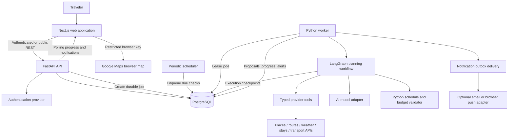
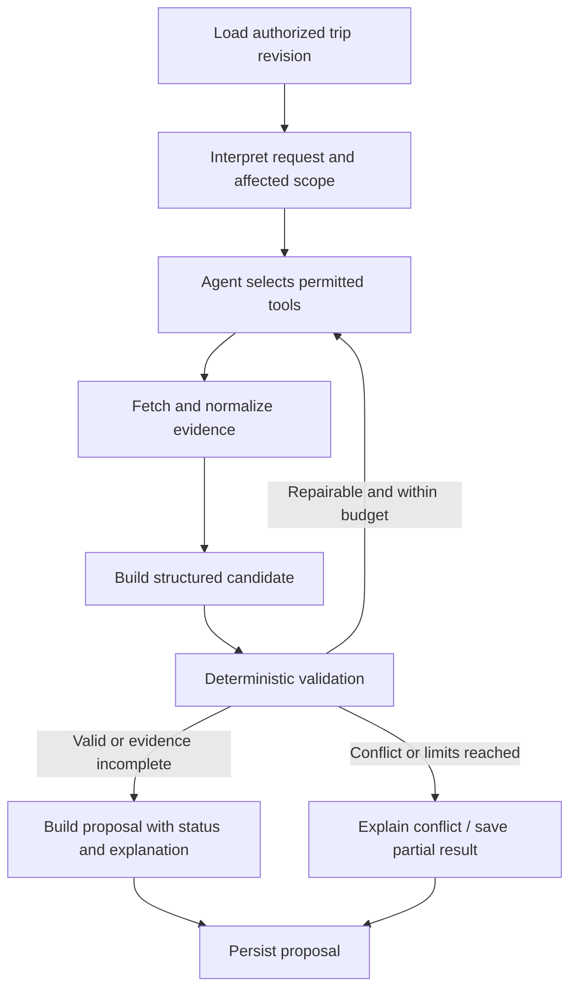

# TripAdapt — System Architecture

**Approval:** Product and technical design baseline approved on 3 November 2026. Unselected vendors, credentials, quotas, notification channel, and other explicitly pending implementation choices remain open; approval does not imply provisioning or implementation.
**Version:** 1.1 draft  
**Date:** 2 November 2026  
**Product release:** V1  
**Baseline:** PRD draft 2.1 plus the subsequently agreed optional background-monitoring requirement.

## 1. Architecture decisions

| Area | Decision |
|---|---|
| Web application | Next.js and TypeScript |
| Application API | FastAPI and Python |
| Primary database | PostgreSQL |
| Agent orchestration | LangGraph; one planning agent initially |
| Schedule and cost validation | Deterministic Python domain logic |
| Deployment structure | Modular monolith with separate API and worker processes from the same backend codebase |
| Interaction | Visual itinerary editor and trip-specific conversation operating on the same records |
| Anonymous access | Destination exploration; rate-limited access |
| Private work | Authentication required to save trips and enable monitoring |
| Monitoring | Opt-in per trip; periodic checks; no continuous location tracking |
| Plan changes | Proposed revision followed by explicit user acceptance |
| Cost posture | Prefer free tiers; enforce application budgets and provider quotas |

This document specifies the architecture rather than provisioned services. Hosting, authentication vendor, AI model, accommodation/transport suppliers, and external notification channel remain implementation selections.

## 2. System boundaries

The product supports multi-destination trips, repeated destination stops, flexible dates, variable duration, overnight transfers, and destination timezones. It combines research, reviews/content, stays, routes, costs, and activities into a connected plan.

Provider coverage and forecast horizons constrain factual information, not the trip data model. Unknown availability must not be interpreted as no availability. The system does not execute supplier bookings, payments, cancellations, or refunds.

## 3. Component diagram



Polling is the initial progress mechanism. Server-sent events can replace polling without changing job ownership. Persistent workers execute long operations; an open browser connection is never required to keep a job alive.

## 4. Backend modules

| Module | Owns |
|---|---|
| Identity and access | Validating sessions/tokens, ownership, public/private rate limits |
| Trips | Trip settings, stop order, shortlists, stays, transfers, activities, commitments |
| Discovery | Place search/details, attributed reviews, external content cards |
| Provider adapters | Authentication, timeouts, normalization, provenance, error classification |
| Planning domain | Time/cost arithmetic, dependency analysis, constraints, feasibility checks |
| Agent orchestration | Graph state, tool selection, bounded reasoning, repair and explanation |
| Revisions | Immutable accepted versions, proposals, acceptance, restoration |
| Jobs | Durable enqueueing, leases, retries, cancellation, progress |
| Monitoring | Preferences, due checks, affected-item detection, alert deduplication |
| Notifications | In-app inbox and optional external-channel outbox |
| Usage control | Provider/model reservations, metering, limits, admission decisions |

Modules communicate through internal interfaces. They are not independently deployed microservices. Next.js handles presentation and browser interaction; business rules and provider/AI orchestration remain in FastAPI/Python. Next.js server handlers may support the chosen authentication flow but should not duplicate the domain API.

## 5. Agent design

A single planning agent can choose among typed tools based on the request and current evidence. A tool is an ordinary backend function with validated arguments and a bounded response; each tool need not be a separate agent.

Candidate tools:

- Search places and inspect selected place details.
- Retrieve supported accommodation offers.
- Retrieve local routes and intercity options.
- Retrieve applicable weather information.
- Inspect current trip, fixed commitments, and unscheduled ideas.
- Validate a structured candidate plan.

Read tools are scoped to the current user/trip. Tools cannot directly accept revisions, change reservations, or perform unrestricted SQL/network access.



Configuration must bound graph steps, model tokens, tool calls, retries, and wall time. Limits are adjustable operational settings. Reaching a limit returns a clear incomplete/conflicted result rather than an unbounded loop.

AI interprets preferences, ranks candidates, and explains alternatives. Python computes money and time, enforces locks, checks routing/opening hours, and controls persistence. Structured output must pass schema validation and entity-ID checks. External reviews and descriptions are untrusted content, not instructions.

The application may store a proposal and end the graph before acceptance. It does not need to leave a graph execution paused throughout user review. LangGraph checkpoints support execution recovery; application revision records support product history.

## 6. Core workflows

### Initial planning

1. User configures a trip and selects or enters relevant stays/transfers.
2. API validates input and atomically creates a job against a specific trip revision.
3. Worker leases the job and loads its authorized inputs.
4. Workflow retrieves relevant evidence and builds a route overview and daily sections.
5. Validator checks each section and cross-destination boundaries.
6. Worker persists the proposal, evidence status, costs, and progress.
7. Client polls job status and renders completed sections.
8. User accepts the proposal through the revisions API.

Long trips are processed incrementally. Intercity transfer and stay boundaries remain shared constraints across sections. Partial sections are drafts, not automatically accepted plans.

### Replanning

The request contains a trigger, selected scope, base revision, and user-confirmed current time/location when appropriate. Dependency analysis identifies affected activities, stays, transfers, and later dates. Only relevant provider data is refreshed. Completed activities and “Keep fixed” commitments are preserved.

If extending Jaipur shifts Udaipur dates, the preview identifies the changed nights, transfers, activities, and required reservation actions. An unavailable hotel offer does not silently replace a booked stay. If arrival cannot meet a fixed activity time, return the conflict and explicit user choices.

### Direct editing and conversational editing

Direct edits submit typed domain commands. Conversation produces the same typed commands or a planning request. Both paths use the same authorization, validation, revision, and acceptance rules. Conversation history supplies context; stored trip records remain authoritative.

### Acceptance and restoration

Proposal acceptance runs in a database transaction: check ownership, check proposal/base revision, validate applicable constraints, insert the accepted revision, and update the current-revision pointer. Where a provider-dependent fact is stale, refresh or mark the proposal for revalidation before acceptance. Availability checks still do not reserve inventory.

A revision conflict returns HTTP 409 and preserves newer user edits. Restoring an earlier plan creates a new revision and rechecks time-sensitive evidence; it does not restore bookings or historical availability.

## 7. Persistence model

| Entity | Important fields and relationships |
|---|---|
| User | External identity subject; ownership |
| Trip | Owner, date mode/window, travelers, rooms, currency, budget mode, current revision |
| DestinationStop | Trip, order, destination identifier, timezone, dates/desired nights; repeated stops supported |
| PlaceReference | Provider and durable identifier; permitted metadata only |
| ShortlistItem | Trip/stop/place, priority |
| Stay | Stop, dates, location, occupancy, booking state, fixed fields |
| TransportLeg | Endpoints, modes, departure/arrival, timezones, booking state, fixed fields |
| Activity | Stop/place, timing, duration, completion, fixed fields |
| CostItem | Unit, quantity, decimal amount, currency, paid/estimated state, inclusions |
| PlanRevision | Immutable structured plan snapshot, parent, author/source, validation result |
| Proposal | Base revision, proposed changes, explanation, evidence status, lifecycle |
| PlanningJob / JobEvent | Owner/trip, base revision, status, lease, attempts, progress, cancellation |
| MonitoringSubscription | Trip, enabled state, period/frequency, next due, consent/preferences |
| MonitoringObservation | Relevant change fingerprint and permitted evidence references |
| Notification / DeliveryOutbox | In-app alert, external delivery status, deduplication key |
| UsageLedger | Provider/model usage reservations, counters, period, outcome |
| Graph checkpoints | Separate schema/tables managed by the checkpoint integration |

Accepted revisions use immutable snapshots for coherent history; current editable trip records and snapshots must be updated in the same acceptance transaction. External review text, photos, and offers must not be copied into permanent snapshots unless permitted. Store durable references, user decisions, and permitted evidence metadata instead.

Use relational columns and constraints for ownership, relationships, ordering, and amounts. JSONB is appropriate for structured revision snapshots and permitted variable metadata, not a substitute for every relationship. Store precise monetary amounts; store timezone identifiers with local scheduling context and UTC instants for dated events. Undated plans remain local draft schedules until dates are assigned.

## 8. API outline

All private resources require ownership checks. Responses use stable identifiers, explicit data statuses, and structured errors.

| Method and route | Purpose |
|---|---|
| GET /destinations/search | Public rate-limited destination search |
| GET /places/search; GET /places/{id} | Discovery and details/reviews |
| POST /accommodation/search; POST /transport/search | Date-specific provider searches |
| POST /trips; GET /trips | Create and list private trips |
| GET /trips/{id}; PATCH /trips/{id}; DELETE /trips/{id} | Manage owned trip |
| POST /trips/{id}/commands | Apply validated structured edits with base revision |
| POST /trips/{id}/messages | Trip conversation and planning requests |
| POST /trips/{id}/planning-jobs | Generate or replan; return HTTP 202 and job ID |
| GET /jobs/{id}; POST /jobs/{id}/cancel | Progress and cancellation |
| GET /trips/{id}/proposals/{proposalId} | Preview |
| POST /trips/{id}/proposals/{proposalId}/accept | Transactional acceptance |
| POST /trips/{id}/proposals/{proposalId}/discard | Discard proposal |
| GET /trips/{id}/revisions; POST /trips/{id}/revisions/{revisionId}/restore | History and restoration |
| PUT /trips/{id}/monitoring | Enable/disable and configure monitoring |
| GET /notifications; PATCH /notifications/{id} | In-app inbox/read state |

Use idempotency keys for generation requests and acceptance actions. Enforce request size limits and cursor pagination where lists grow. Cancellation is cooperative at safe boundaries and cannot undo provider calls already made.

## 9. Durable jobs and concurrency

Use a PostgreSQL-backed job table initially, avoiding a mandatory Redis deployment. Workers claim jobs using transactional row locking, such as FOR UPDATE SKIP LOCKED, with leases, heartbeat timestamps, attempt limits, and delayed retries. Implement and test lease expiry and crash recovery.

Execution is at least once. Tool steps and persistence therefore require idempotency; do not assume checkpoints make external side effects exactly once. Graph execution uses stable job/attempt identifiers with checkpoint compatibility verified against the installed version. Keep the database transaction short and outside slow API/model calls.

Persist job creation alongside its application request. Record progress durably. Before saving a usable proposal, compare its base revision with the current trip. Cancel or supersede obsolete jobs. Bound simultaneous jobs globally and per user.

LangGraph does not replace the worker, scheduler, queue admission rules, or application transaction layer.

## 10. Optional background monitoring

Monitoring is off by default and enabled per saved trip. Explain benefits, periodic-check limitations, possible unnecessary alerts, chosen channel, and how to disable it. No device location permission is required.

A periodic scheduler identifies eligible due subscriptions and enqueues lightweight checks. Eligibility requires useful dated upcoming/active trip items; checks stop after trip completion. Frequency, advance horizon, and daily quotas are configurable and should become more selective for distant dates. An authenticated scheduled trigger may wake a bounded worker batch where hosting permits; an always-running worker is also supported.

Use ordinary provider requests and deterministic impact checks first. Invoke the planning agent only for a meaningful affected plan or a user-requested revision. Deduplicate alerts by trip/item/change fingerprint, apply cooldowns, and respect available notification preferences. Forecast fluctuations should not generate an alert every time they change.

Monitoring never accepts a revision. If limits or outages prevent checks, show last successful check and paused/unavailable status. In-app notifications are the baseline delivery mechanism. Email versus browser push remains pending; include a delivery adapter and transactional outbox so a channel can be added without changing planning logic. External notifications while the app is closed require selecting and configuring one of those channels before that behavior is considered complete.

## 11. Provider integration and content

Google Maps JavaScript API, Routes API, and Places API are proposed for maps, routing, and discovery. Browser map keys are intentionally public but website/API-restricted; server credentials remain secret. Other providers remain subject to access, region coverage, cost, and terms checks.

Adapters return normalized results with source, retrieval time, applicable dates, original currency, and status: sourced result, estimate, user-entered, unavailable, or simulated. Classify timeout, quota, unsupported coverage, authentication failure, and no-result outcomes separately.

Reviews retain source/author/date attribution and original links. AI summaries are separately labeled: “AI-generated summary of available reviews. AI can make mistakes; check the original reviews before deciding.” Show the number and sources summarized. Verify processing permissions before passing provider reviews to an AI service. If unavailable, display permitted originals or an authorized provider summary. Do not fabricate consensus or reviews.

Respect caching, retention, photo/embedding, and map-display requirements. No unrestricted raw-provider response archive is assumed. Existing transport bookings can be entered manually and labeled user-entered. Forecasts beyond a provider horizon remain unavailable.

## 12. Usage and cost enforcement

Free tiers are preferred, not a guarantee of zero operating cost. Current provider limits must be checked during provisioning. Every external call passes admission control before execution.

- Maintain global and per-user request/job limits and provider-specific counters.
- Atomically reserve an upper-bound model token/call allowance before work; reconcile afterward.
- Track the billing unit: requests, map loads, photos, route-matrix elements, tokens, or another applicable unit.
- Use a conservative safety margin and fail closed when the remaining budget cannot safely cover work.
- Configure provider-side quotas where available; browser map usage requires provider controls as well as application controls.
- Bound tool loops, candidate counts, concurrency, retry attempts, and response sizes.
- Load photos/reviews on demand and debounce search. Reuse data only where provider terms permit.
- Give interactive requests priority over monitoring; pause monitoring when its allocation is exhausted.
- Return clear quota status and retry/reset information instead of fabricated fallback results.
- Restrict keys and configure billing alerts. Alerts alone do not stop spending.

A strict application budget cannot guarantee an exact currency cap when provider billing is delayed or browser activity is independently metered. Combine application reservations, conservative limits, and provider controls, and document residual billing exposure before enabling paid overages.

## 13. Authentication and security

Use a managed standards-based identity provider, selected during implementation. FastAPI validates issuer, audience, signature, and expiry for the chosen token flow; never trust a user ID supplied in request content. Apply ownership checks to trips, jobs, conversations, proposals, and notifications.

Restrict CORS to approved web origins. If cookie-based API authentication is chosen, include CSRF protection; otherwise use an appropriate short-lived token flow. Store secrets in environment-managed configuration. Redact tokens, booking references, and unnecessary personal information from logs. Give the agent only scoped tools and bounded input; no arbitrary code execution is required.

## 14. Reliability and observability

**Proposed tools:** LangSmith for LangGraph/model/tool execution traces and offline evaluation cases; Sentry for Next.js, FastAPI, and worker exception reporting and sampled performance traces; hosting logs/health checks for service operation. These monitor the application, independently of traveler disruption monitoring. Carry request_id, job_id, version_id, and trace/run identifiers across boundaries. OpenTelemetry is an optional vendor-neutral instrumentation layer as tracing needs grow, not another dashboard required for V1.

Track queue age, job completion/failure, tool/model latency, validation/repair counts, token usage, provider errors/429s, database failures, worker heartbeats, monitoring freshness, and notification delivery failures. Alert developers for sustained failures, stalled workers, and approaching allowances. Sample successful traces, bound export volume and retention, disable paid overages where supported, and keep operational logs when trace allowance is exhausted. Redact secrets, emails, booking references, and restricted provider payloads before export; do not enable unrestricted prompt/response capture. Observability delivery is best effort and must not block user operations. Exact plan allowances are verified during provisioning.


Use structured logs with request, trip, revision, job, graph-step, and provider-call identifiers. Track job duration/failure, validation failures, tool counts, quota refusals, monitoring freshness, and delivery attempts. Persist user-facing progress separately from diagnostic traces. Full model inputs/outputs should not be logged by default.

Retry transient failures with bounded backoff and jitter. Do not retry permanent authentication or unsupported-coverage errors as if transient. Preserve the accepted plan during outages and distinguish partial evidence from validated facts. Clean up expired proposals, job events, checkpoints, and content according to configured retention and provider terms.

## 15. Deployment and repository layout

```text
apps/
  web/                     # Next.js and TypeScript
services/
  backend/
    app/
      api/                 # FastAPI routes and auth
      trips/ discovery/    # Domain modules
      planning/            # Validator, dependency analysis, costs
      agents/              # LangGraph workflow and typed tools
      providers/           # External adapters
      jobs/ monitoring/ notifications/
      persistence/         # Models and repositories
    migrations/
    tests/
docs/
```

Deploy web, API, worker/scheduler execution, and managed PostgreSQL as logical components. API and worker share backend artifacts and migrations. Local development can use containers for PostgreSQL and separate commands for web/API/worker. Database migrations run once per release through a controlled command.

Choose hosting only after checking runtime, sleep behavior, worker execution, database connection limits, outbound access, and scheduler allowances. A sleeping free API cannot provide guaranteed immediate alerts. Do not put durable planning into an untracked request-local background task. If no acceptable free worker/scheduler exists, document the service limitation or approve a hosting cost; do not silently drop monitoring.

## 16. Verification

- Unit tests: constraints, conflicts, budget units, timezone/overnight transfers, dependency scope.
- Integration tests: provider normalization/failures, authorization, acceptance transactions, usage reservations.
- Worker tests: duplicate execution, lease expiry, retries, cancellation, stale proposals, checkpoint recovery.
- Monitoring tests: consent, eligibility, change detection, deduplication, quotas, delivery retries.
- End-to-end: multi-destination setup → discovery → itinerary → disruption → preview → acceptance → reopen/restore.
- AI evaluation cases: valid tool use, fabricated identifiers, missed locks, incomplete evidence, bounded repair, prompt injection in source text.

Use synthetic or permitted fixtures for reproducible checks; separately smoke-test real providers. Do not retain restricted provider content as test fixtures without permission.

## 17. Remaining selections

| Selection | Decision criterion |
|---|---|
| Authentication provider | Next.js/FastAPI interoperability, free allowance, token validation |
| AI provider/model | Tool calling, structured output, measured planning quality, limits and price |
| Accommodation/intercity providers | Authorized access, coverage, useful date-specific inventory, cost |
| Weather provider | Coverage, forecast horizon, free allowance |
| Hosting/database vendor | Free-tier limits, worker/scheduler support, connection limits and sleep behavior |
| External notification channel | Email versus browser push; permission/delivery setup |
| Operational defaults | Check cadence, monitoring horizon, token/job ceilings, retention periods |

No additional agent framework, vector database, Redis service, or microservice deployment is required by this initial architecture. Introduce these only when an actual implementation need justifies them.

## 18. References and document precedence

- Product baseline: [PRD draft 2.1](tripadapt-prd-v2.md).
- LangGraph reference: https://reference.langchain.com/python/langgraph/overview
- PostgreSQL documentation: https://www.postgresql.org/docs/current/
- Places API policies: https://developers.google.com/maps/documentation/places/web-service/policies
- Google Maps cost controls: https://developers.google.com/maps/billing-and-pricing/manage-costs

The user's later approval of opt-in monitoring supersedes the PRD sentence excluding scheduled background monitoring. The PRD has received that narrow synchronization update; its other agreed scope remains in place. API examples and table names are approved design contracts to refine during implementation, not claims that code already exists.


## 11 November 2026: hosted discovery and mapped AI evidence

The existing FastAPI/PostgreSQL-leased LangGraph worker now supports explicitly requested mapped-place evidence. Geoapify is the configured hosted discovery path after public Overpass failed locally. Provider I/O and immutable snapshot retention happen before model composition; the model receives a bounded read-only catalog, not provider credentials or arbitrary query tools. Dynamic schema candidate IDs, deterministic activity construction and database source/freshness verification constrain publication and acceptance. Old jobs retain labeled sample mode. New browser requests opt into mapped evidence and fail visibly when discovery is unavailable. No migration, new agent framework or deployment change is introduced. See docs/activity-discovery.md for live verification.
